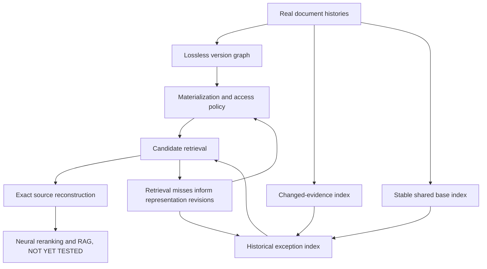

# CDG Round 3: Real History, Change-Index Completeness, and Access-Aware Compression

**Study date:** November 8, 2026  
**Status:** Locally executed exploratory research. Neither a production RAG system nor a claimed new algorithm.

## Research question

Can a lossless versioned data store preserve exact source versions while using shared context, changed evidence, and exception passages to reduce retrieval-index bytes and improve finding individual revisions? Can workload-aware materialization reduce the cost of reconstructing compressed versions?

## Environment and reproducibility

- Repository: public **noVNC**, checked out locally at `7fcf9dcfe0cc5b14e3841a4429dc091a6ffca861` (the original local Git history was read, never modified).
- Retrieval experiment: **250 actual single-file commits** affecting **56 paths**, sampled chronologically from a local history. Human-written commit subjects are queries. Exact matching changed file-version is the automated relevance label. This is a **proxy retrieval task**; other revisions of the same file may also be semantically relevant, so the labels are noisy.
- Version-storage experiment: **18 actual file histories**, **10 Git versions each**.
- Separate storage/decode stress tests: **48 real technical-document bodies** with **7 controlled synthetically edited versions each**, including interior insertions, replacements and deletions. The underlying text documents are local and not redistributed.
- Python NumPy/SciPy/scikit-learn; zstd through ctypes/libzstd. CPU warm-cache reconstruction. No GPU or pretrained neural embeddings were available. No end-to-end LLM inference or SSD benchmark occurred.

## A. Real-history retrieval, sparse TF-IDF

| Method | Hit@1 | Hit@5 | Hit@10 |
|---|---:|---:|---:|
| Full-file TF-IDF | 15.2% | 36.4% | 47.2% |
| Changed regions only | 36.4% | 64.0% | 71.6% |
| Full file plus changed regions (70% change weight) | 37.2% | 67.2% | 73.6% |
| One shared file base plus changed regions | 36.8% | 67.6% | 73.6% |

**Compressed serialized sparse-index storage:** 911,926 bytes full-file; 95,338 bytes changed regions; 198,394 bytes 56 shared bases; 287 bytes family map. Together shared-base + changed regions = **294,019 bytes**, compared with 1,007,264 bytes for the full-file + change dual index. The two-index comparison does not include source storage or shared vocabulary. Sparse-matrix compressed serialization is not the same as a tuned disk-resident, random-access search engine.

The real-history proxy strongly favors changed-region retrieval on these *change-intent queries*, but the result does **not** imply superiority for general scientific QA.

## B. Stronger BM25 control

The BM25 experiment changes the conclusion about fusion. With standard full-vocabulary BM25, the full-file Hit@5 was **12.8%** and changed-region Hit@5 was **41.6%**. Independent score-normalized fusion with 75% diff weight gave **41.2%**, not a consistent win over changed-region BM25. The relative full/diff balance is highly sensitive to the scoring and normalization scheme. Temporal subsets likewise did not establish a reliable universally optimal fusion weight.

## C. Why the shared-base index was initially incomplete

For each historical version, we compared source unigrams to the union of (1) its path-level canonical base and (2) its exact changed-region retrieval text.

- **172/250 historical versions** contained at least one missing source unigram.
- **3,177/87,777** document-specific distinct term occurrences were not represented by either channel, approximately **3.62%**.
- A search requiring one of these omitted terms could fail to retrieve its original version, even though the losslessly stored source bytes could be reconstructed.

We constructed a third, provenance-preserving exception channel by taking verbatim source lines from each original version until all missing unigrams were covered. This required **1,802 lines** across the 250 versions. The exact lines together occupied **85,097 source bytes**, compressed as a single illustrative archive to **8,378 bytes**. Their TF-IDF search matrix added **43,292 compressed bytes**.

| Index configuration | Compressed search index |
|---|---:|
| Full-file | 915,513 B |
| Shared base + change | 294,447 B |
| Shared base + change + exceptions | **337,739 B** |

All original unigrams were covered after adding exceptions. In this configuration, one simple three-channel score combination achieved **67.2% Hit@5**, compared with **36.0%** for full-file indexing on the same human commit-message proxy. Another fusion formula did worse. This is *candidate search coverage*, not guaranteed phrase retrieval, exhaustive top-k recall, grounded QA, or neural semantics.

**Important:** Choosing exception snippets based on source features alone avoids using evaluation labels, but the search representation is not yet a full index of all historical text. A version-specific positional, phrase, or semantic search requirement might demand extra indexes or exact reconstruction.

## D. Lossless storage with interior edits (synthetic revisions)

48 document families, 7 versions each. Numbers below are bytes of source storage alone, with compressed line-edit patches verified by exact reconstruction.

| Interior line edits | Independent zstd3 | Shared-base exact patches | Solid zstd9 |
|---|---:|---:|---:|
| 0.1% | 1,130,629 | 185,534 | 125,896 |
| 1% | 1,133,338 | 194,075 | 129,639 |
| 5% | 1,137,067 | 221,953 | 151,158 |
| 20% | 1,136,177 | 296,543 | 222,680 |

Solid zstd remains smaller but does not provide independent per-version random access. The family patch approach trades a larger compressed footprint against selective reconstruction.

A separate access-skew experiment at 5% edits observed:

- Patch source archive **221,953 B**.
- Patch archive plus a materialized hot version per family **384,836 B**.
- Independently compressed sources **1,137,067 B**.
- Under a synthetic workload sending 75% of accesses to the designated hot version, median reconstruction was approximately **0.0575 ms** from patches versus **0.0279 ms** with hot-version copies.
- Holding **447,583 B** of decompressed family bases in RAM further improved some access patterns, but consumes that additional memory. Uniform accesses reduce the benefit of a single designated hot copy.

These timings are Python-level, warm-cache, small-file microbenchmarks. They do not demonstrate actual faster RAG.

## E. Compression across 180 *real* Git versions

On 18 noVNC files with 10 actual historical snapshots each:

| Lossless source layout | Total compressed bytes |
|---|---:|
| Independent zstd3 versions | 865,997 |
| Latest version + direct patch to each historical version (star) | 229,556 |
| Latest version + adjacent-version patch chain | **149,307** |
| Full checkpoint every 5 versions | 229,503 |
| Full checkpoint every 3 versions | 385,191 |
| Workload-aware DP checkpoint selection | **346,864** |
| Solid zstd9 archive | **91,516** |

All reconstructed snapshots verified byte-exact. The DP solver assumes Zipf-like access favoring recent versions and optimizes compressed storage bytes plus 20,000 bytes for each expected patch application. Under that *assumed* access distribution, expected patch depth was **2.026** for the chain, **0.638** with checkpoints every three versions, and **0.459** for the DP selection. These are **patch counts**, not measured wall-clock retrieval times. The DP objective parameter was chosen illustratively rather than learned from real query logs.

## F. The most important prior-art correction

The storage-recreation optimization is **not new**:

1. Bhattacherjee et al., *Principles of Dataset Versioning: Exploring the Recreation/Storage Tradeoff* (PVLDB, 2015), formalizes version graphs, delta/materialization costs, and workload-aware recreating: https://pmc.ncbi.nlm.nih.gov/articles/PMC5526644/
2. *DEX* (SIGMOD 2017), processes queries directly over dataset deltas rather than necessarily reconstructing entire versions: https://doi.org/10.1145/3035918.3064056
3. He, Yan, and Suel, *Compact Full-Text Indexing of Versioned Document Collections* (CIKM 2009): https://doi.org/10.1145/1645953.1646008
4. Gandhi, Gao, and Callan, *Repository-level Code Search with Neural Retrieval Methods* (2025), uses commit histories and neural reranking: https://arxiv.org/abs/2502.07067
5. Levi et al., *IDEA* (USENIX FAST 2024), deduplication-aware source indexing: https://www.usenix.org/conference/fast24/presentation/levi

**Conclusion:** Source version graphs, adaptive materialization, and direct delta query processing have strong prior art. Our implementation of them is a reproducibility baseline, not a research innovation. A credible CDG contribution would need to show a new **joint search/index/source-layout optimization** that improves over these baselines.

## G. Graph-of-thoughts status

**Retain:** Three-channel search with exact exception passages; byte-exact version graph; workload-aware source caching.

**Do not treat as new:** Delta compression, cache placement, change-only retrieval, version checkpoints, normalized two-score fusion.

**Critical limitations:** One public repository; heuristic labels; lexical retrieval, not neural RAG; model and index loading costs unmeasured; code rather than scientific/financial text; lossless source store but not yet guaranteed full semantic evidence reachability.

## H. Next experimental gate

Run with a **pretrained dense retriever and BM25** on genuine revision corpora and an external dataset with independent relevance judgments. Require a correct-version evidence recall metric and a no-regression test on unmodified facts, negations, numerical changes, and exact citations.

Compare full-document passage retrieval, versioned inverted indexes, shared base + changes, shared base + changes + exceptions, and any hybrid. Count **source bytes + index bytes + vocabulary/model bytes + caches**, evaluate SSD warm/cold p95 latency, index update time, recall, and end-to-end RAG quality. Only investigate a learned optimizer after verifying that the storage/latency frontier changes at equal evidence recall.

## Reproducibility limitations

All new round-3 scripts and JSON outputs accompany this report. The code reads the noVNC Git history from `/opt/novnc`; users reproducing the experiments can clone `https://github.com/novnc/noVNC`, check out commit `7fcf9dcfe0cc5b14e3841a4429dc091a6ffca861`, and update the repository path in the scripts. The synthetic-edit benchmark additionally relies on the local technical-document collection used in round 2; those background files were not redistributed.
