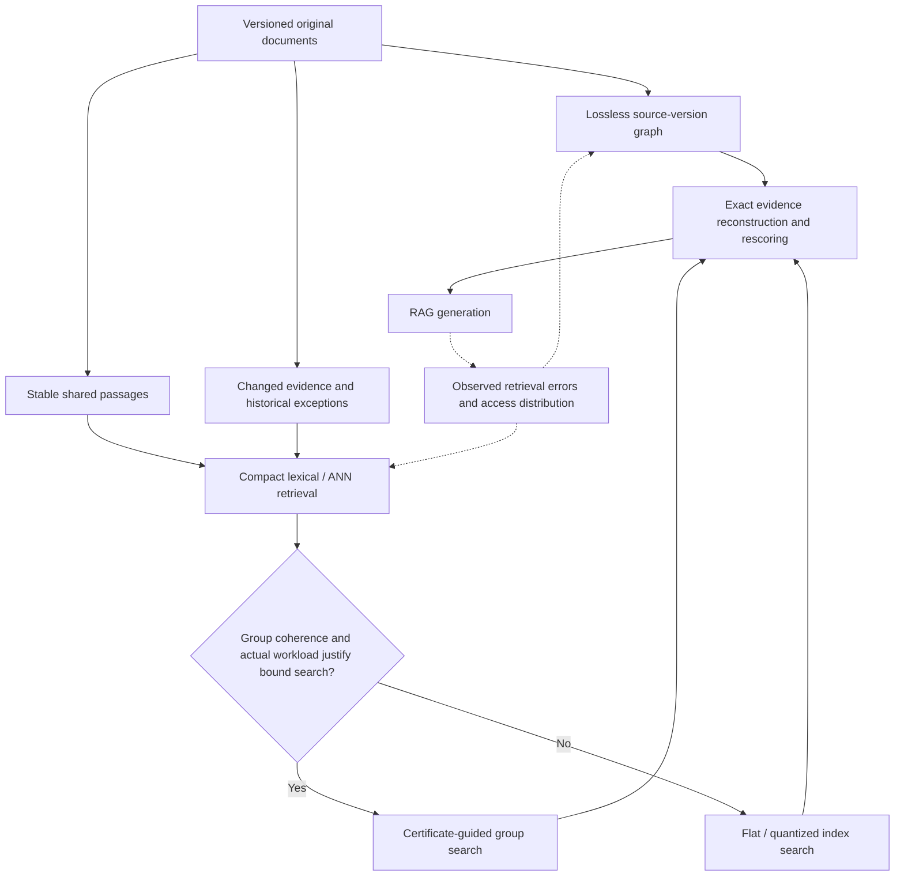

# CDG Round 4: Group Coherence, Difference-Aware Retrieval, and Adaptive Search

**Study date:** November 9, 2026  
**Status:** Completed CPU experiments. No pretrained dense encoder, production ANN service, or end-to-end RAG tested.  
**Question:** Can the structure already useful for lossless document-version compression reduce semantic search work, and is a shared residual vector encoding competitive against conventional quantization?

## Executive finding

**Three empirical conclusions:**

1. On 250 real source-code versions, group-level score bounds skipped 76.9 to 94.5 percent of exact document dot products, but **increased wall-clock query time** versus a vectorized full scan. There is no demonstrated real-corpus retrieval acceleration.
2. On favorable *synthetic* clustered vector datasets with 5,000 to 50,000 vectors, group-level bound search was 4.6 to 9.3 times faster than exhaustive dot products. On dispersed vectors, it was roughly 11 to 18 times slower. A 10-query offline pilot successfully selected the faster backend across the 9 tested conditions and held that choice on 60 held-out queries per condition. This is a workload-conditioned proof of concept, not production ANN performance.
3. On the same real commit-query proxy, a **standard int8** vector encoding was generally better than our specialized shared-centroid residual encodings in the index-size/recall trade-off. Conversely, indexing actual changed text improved commit-message retrieval quality over full-document text. Those two findings favor keeping **source-level version compression** separate from the best available **vector quantizer**, while adding a targeted change-evidence retrieval channel.

## A. Real noVNC experiment

- 250 genuine single-file Git revisions and human-written commit messages, covering 56 paths, from the public noVNC repository at commit `7fcf9dcfe0cc5b14e3841a4429dc091a6ffca861`.
- Each commit message targets its corresponding new file revision. This is a noisy proxy relevance label, not an independent human annotation.
- Fit TF-IDF (word unigrams/bigrams) and `TruncatedSVD(n_components=96)` on file versions and their changed regions. Queries are projected into this basis. The resulting vectors are **non-neural LSA proxies**, not pretrained embedding-model outputs.
- Candidate similarity is cosine-equivalent dot product after normalization. Exact top-k refers only to this surrogate score.

### A1. Retrieval relevance of change regions

| 96D LSA representation | Hit@1 | Hit@5 | Hit@10 |
|---|---:|---:|---:|
| Entire changed source file | 10.8% | 36.0% | 46.4% |
| Changed passages only | 31.2% | 62.4% | 70.8% |
| Equal-weight fusion | 30.0% | **63.6%** | **72.4%** |

Fusion weight 0.5 was fixed, not tuned against test labels. Changed-region retrieval naturally benefits from commit-message intent and cannot be extrapolated to general-purpose document QA.

### A2. Certified group-based exact score search

Represent each group by centroid `c_g` and radius `r_g = max_{v in g} ||v-c_g||`. For a unit query vector, all member scores satisfy

`q·v <= q·c_g + r_g`.

If a group's upper bound is lower than the current exact kth score, that group can be discarded while preserving the original normalized-dot-product top-k score (subject to floating-point tolerances). Version groups came from file paths, with contiguous within-path subgroups.

| Maximum versions per group | Groups | Mean exact document scores | Fraction of documents skipped | Median exhaustive latency | Median bounded Python latency |
|---|---:|---:|---:|---:|---:|
| 2 | 146 | 13.76 / 250 | 94.49% | 7.89 µs | 32.84 µs |
| 3 | 112 | 23.93 / 250 | 90.43% | 7.92 µs | 39.01 µs |
| 4 | 94 | 32.74 / 250 | 86.90% | 7.88 µs | 40.23 µs |
| 8 | 71 | 57.82 / 250 | 76.87% | 7.89 µs | 49.27 µs |
| Entire source family | 56 | 119.24 / 250 | 52.31% | 7.94 µs | 58.15 µs |

**Key negative result:** counting skipped dot products exaggerates actual acceleration. The sorted-group and per-group Python overhead dominates at this scale. Repeated timing runs differ slightly due to CPU scheduling.

The separate score-level verifier confirms the top-five *scores* agree with exact search to at most `1.79e-7` across 250 queries and all tested group sizes. Document identities can differ at near-equal scores because of tie-breaks and float rounding.

## B. Shared residual vectors versus standard vector quantization

We stored a shared 96D center per file family, then retained only the top-m coordinates of each version's difference from its center. This is **lossy index compression** even though the underlying source text is preserved exactly in the independent source archive.

| Vector encoding | Compressed bytes for 250 vectors | Exact-top5 overlap after 4x oversampling + full-vector rescoring |
|---|---:|---:|
| Plain per-vector int8 with scales | **13,468 B** | **100.0%** |
| Shared center + top 4 residual dimensions | 12,869 B | 94.24% |
| Shared center + top 8 residual dimensions | 15,156 B | 97.20% |
| Shared center + top 16 residual dimensions | 19,785 B | 98.48% |
| Shared center + top 24 residual dimensions | 24,415 B | 99.28% |

The top4 residual method saved ~4% storage relative to int8 but lost substantial candidate recall. At higher fidelity levels, the specialized residual encoding was larger than int8. Values are zlib-compressed vector-array payloads and are **not** complete ANN index sizes. Exact rescoring assumes original full-precision vectors can be retrieved; that extra storage and I/O cost is not included here. No state-of-the-art PQ or TurboQuant implementation was run.

**Verdict:** Do not build a novel centroid-residual embedding codec until it beats optimized int8/product-quantization baselines. We should keep the shared version structure for **lossless source compression**, while using a well-optimized independent ANN representation unless experiments demonstrate a benefit.

## C. Larger-scale synthetic coherence test

Generated 96-dimensional normalized vectors around a set of independent family centers. Sigma controls dispersion of members from their family center, not model uncertainty. Query vectors were small perturbations of a sampled member. Each combination used 70 queries, with 10 pilot queries used to choose the backend and 60 held out for reporting.

| Corpus size | Sigma | Median family radius | Held-out flat median | Held-out bound median | Chosen backend |
|---|---:|---:|---:|---:|---|
| 250 | 0.02 | 0.185 | 5.6 µs | 8.4 µs | Flat |
| 5,000 | 0.02 | 0.214 | 86.1 µs | **18.6 µs** | Bounded |
| 50,000 | 0.02 | 0.213 | 1,304 µs | **140.5 µs** | Bounded |
| 50,000 | 0.10 | 0.771 | **1,569 µs** | 17,234 µs | Flat |
| 50,000 | 0.25 | 0.980 | **1,794 µs** | 19,125 µs | Flat |

All nine generated conditions are in `round4_adaptive_results.json`. Bound-search top-five score thresholds passed in all 60 held-out queries in each condition.

**Important:** These vectors are **synthetic**, and the tighter groups were generated by design. The pilot selection costs, group construction time, data loading, and source-level compression costs are omitted. No claim about real neural embedding performance or actual RAG latency follows from this test.

## D. Updated Graph of Thoughts

### Retained ideas

- Real-document *change regions* are useful retrieval representations in change-intent queries.
- Lossless version graphs can reduce redundant source storage, as prior experiments demonstrated.
- Coherence-based group search can certify exact score rankings on suitable tight clusters, but only as an optional search backend.
- Use compact conventional quantization unless a special compressed representation beats it at equal fidelity.

### Rejected / unsupported ideas

- Group bounds are **not** automatically fast. They failed the real 250-item latency test.
- Embedding residual compression did **not** outperform simple int8 under comparable accuracy requirements.
- Improving surrogate-vector top-k is **not** proof of improved answer completeness, numerical correctness, or RAG factuality.
- Tree routing and delta compression themselves are established techniques, not CDG discoveries.

## E. Relevant primary literature

1. **TimelyRAG** (Findings EMNLP 2026), temporal ranking in overlapping-evolving regulations: https://aclanthology.org/2026.findings-emnlp.398/
2. **TEMPO** (EMNLP 2026), temporal-reasoning retrieval benchmark with 1,730 queries: https://aclanthology.org/2026.emnlp-main.291/
3. **RARE / RedQA** (ACL 2026), retrieval on redundant finance/legal/patent documents: https://aclanthology.org/2026.acl-long.923/
4. **Lost in Embedding / RecovIR** (Findings EMNLP 2026), loss of entity/date/relation information in dense retrievers: https://aclanthology.org/2026.findings-emnlp.2307/
5. **MV-IVF** (November 6, 2026 preprint), hierarchical clustering and low-bit quantization for multi-vector retrieval, closely overlaps predictive tree ideas: https://arxiv.org/abs/2611.09040
6. **Qdrant quantization documentation** on scalar, binary, product quantization, oversampling, and full-vector rescoring: https://qdrant.tech/documentation/manage-data/quantization/
7. **NVIDIA cuVS IVF-PQ** on residual product-quantization and GPU search: https://developer.nvidia.com/blog/accelerating-vector-search-nvidia-cuvs-ivf-pq-deep-dive-part-1/
8. **Metric-tree high-dimensional limitations**: https://arxiv.org/abs/0812.0146
9. **Principles of Dataset Versioning**, PVLDB 2015: https://pmc.ncbi.nlm.nih.gov/articles/PMC5526644/
10. **IDEA**, FAST 2024, deduplication-aware indexing: https://www.usenix.org/conference/fast24/presentation/levi

These papers are close prior art, not evidence of a uniquely CDG mechanism.

## F. Recommended next research gate

**Do not build a custom neural codec or giant agent fleet next.** The next decisive experiment should run a real pretrained retriever on a versioned QA corpus with independent relevance annotations.

Suggested benchmark sequence:

1. TimelyQABench (TimelyRAG) to evaluate version correctness and temporal amendments.
2. TEMPO to evaluate retrieval across multiple required time periods.
3. RARE/RedQA to evaluate distinguishing facts in highly redundant financial/legal/patent collections.
4. A standard corpus without extreme redundancy, to detect harmful over-specialization.

All candidates must compare against tuned BM25, full passage embeddings with HNSW/FAISS/Qdrant, standard vector quantization, time-aware ranking, and ordinary versioned inverted indexes. Evaluate lossless bytes + index bytes + model/caching costs, p50/p95 end-to-end query latency, update cost, correct-version recall, temporal coverage, and final answer correctness.

**Research hypothesis emerging from this round:** A version-compressed source store with explicitly protected changed evidence and a coherence-gated retrieval controller may improve the storage-latency-quality frontier on evolving redundant corpora. The combined system is **not validated**, and most underlying techniques have established precedents. A nontrivial contribution requires showing improvements over separately optimized strong baselines on real QA data.
