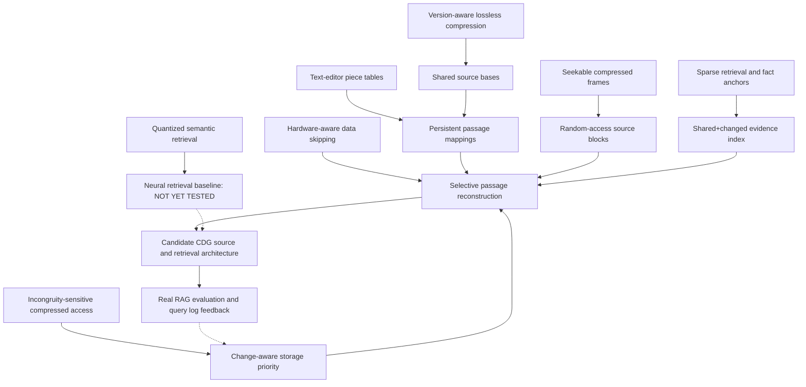

# CDG Round 5: Search-Weighted Version Compression and Direct Passage Reconstruction

**Date:** 2026-11-09  
**Status:** Reproducible CPU experiments on real version histories. **NOT neural RAG, not an established new algorithm, not production SSD measurements.**  
**Question:** Can a lossless versioned source representation cut combined storage and reconstruct the *short passage RAG actually needs* faster than independent document compression?

## Executive finding

This round combined ideas from text-editor **piece tables**, version-delta storage, individually accessible Zstandard frames, retrieval indexes, and compressed string random-access research.

- The naive approach (shared compressed base plus full-version patch reconstruction) reduced source storage but was about **2.9 times slower** than independent Zstandard full-document decoding in the tested Python implementation.
- A **piece-mapped source** stored the corpus at **666,829 bytes** versus **1,455,847 bytes** for independent Zstandard. Its compact 17-byte piece records occupied **298,578 bytes** in resident representation. Five-line random-window access took about **29 µs median** versus **57 µs** for full-document independent decompression. Independently seekable 32-line Zstandard frames were slightly faster but used **2,528,761 source bytes**.
- **Critical corrected result:** Changed-region requests, which are especially relevant to version-aware RAG, are harder. The original compressed per-version literal buffer took about **75 µs**, versus **70 µs** for independent full decompression and **31 µs** for independently seekable 32-line frames in a same-run benchmark. Random windows overstate how well the representation serves changed evidence.
- **New candidate:** Store tiny changed literals directly while compressing larger literals separately. The **64-byte threshold** variant used **980,087 source bytes** and took **48.93 µs median** on changed-evidence windows, versus **1,455,847 bytes and 69.80 µs** for full independent Zstandard in the same run. The 256-byte threshold traded slightly more storage (**1,038,253 bytes**) for **46.48 µs** median. This is an exploratory operating point selected using the measured workload, not a validated general-purpose algorithm.
- A separate experiment found that merging weighted full-document and changed-region BM25 matrices reduced compressed postings from **325,660 bytes to 298,467 bytes**, with median query-time sparse scoring of **231.89 µs vs 299.42 µs**, while preserving the same additive ranking scores.

The strongest systems hypothesis now is **query/access-aware organization of shared source pieces**, with changed evidence receiving a different coding strategy from stable text. Neural retrieval quality and real end-to-end latency remain untested.

## Graph of Thoughts

**Important boundary:** A lossless source representation guarantees byte-exact reconstruction, **not** retrieval completeness. The query and retrieval engines require separate evaluation.

## Data and reproducibility

- Public local **noVNC** Git history at `7fcf9dcfe0cc5b14e3841a4429dc091a6ffca861`.
- 250 genuine source-code revision snapshots, 56 unique file paths; **6,234,330** original source bytes.
- The 250 human-authored commit subjects act as queries. Their labels are the file revision from the same commit, **not independently annotated question-answering relevance judgments**.
- Retrieval experiments use lexical unigram BM25 on full files and changed passages. No pretrained encoder was available locally; package/model downloads could not be obtained in this runtime. We did not represent SVD or TF-IDF as a trained dense neural retriever.
- Compression uses libzstd through a tiny Python ctypes wrapper. Index storage uses zlib-compressed sparse arrays, which is consistent across the compared index methods.
- Passage experiments select 5-line windows from actual version snapshots, including separate tests targeting stable source pieces and modified source pieces. Reconstruction results are checked against original bytes.

## Experiment 1: Single merged sparse index

| Measurement | Two separate score matrices | One merged score matrix |
|---|---:|---:|
| Compressed postings | 325,660 B | **298,467 B** |
| Median per-query scoring | 299.42 µs | **231.89 µs** |
| p95 per-query scoring | 486.66 µs | **383.98 µs** |
| Same-commit Hit@5 | 62.4% | **62.4%** |

Matrices have the same shared vocabulary (additional 21,380 B). A merged matrix is formed by adding BM25 field weights, allowing one sparse multiplication rather than two. Scores are equal up to numerical tolerance. This is a straightforward field-index optimization, not novel by itself.

### Retrieval quality uncertainty

- Full-file BM25 Hit@5 on all 250 queries: **29.6%**.
- Changed-region BM25: **61.6%**.
- Merged score: **62.4%**.
- Paired percentile bootstrap for `changed - full`: **+32.0 percentage points**, 95% interval **[+24.8, +39.2]**.
- For `merged - changed`: **+0.8 points**, 95% interval **[-2.8, +4.4]**. No clear evidence here that merging improves relevance beyond a strong changed-region-only retriever.

This commit-message task is inherently about what changed. The result does not imply changed-region retrieval should dominate general RAG.

### Low-index-budget vocabulary test

At a budget of 512 vocabulary terms on held-out commit queries, a frequency-selected merged index achieved Hit@5 **45.2%**, while a heuristic selecting only change-salient terms achieved **19.9%**. Naively protecting novelty can discard essential general terms. We should learn or validate query-sensitive budget allocation, not optimize rare-term coverage alone.

Family-aware IDF offered modest, inconsistent split-dependent gains. The weights maximizing the training split did not yield the best held-out score, and no robust conclusion follows.

## Experiment 2: Complete-source lossless storage

| Physical source representation | Bytes |
|---|---:|
| Independently compressed Zstandard versions | 1,455,847 |
| First-observed version per family plus individual full-version patches | **472,650** |
| Independently compressed 32-line seekable frames | 2,528,761 |
| Solid Zstandard archive (not independently seekable) | **178,735** |

All original source bytes were reconstructed exactly. The compact star representation saves space, but reconstructing a complete file from its compressed patch costs more CPU: **37.79 µs** independent median versus **111.03 µs** patch reconstruction median. Caching uncompressed base files helps to **79.72 µs** at additional memory cost.

With the *same* merged retrieval matrix and vocabulary, the source+index representation is ~**1.776 MB** for independent compression and ~**0.792 MB** for the star patch archive. This excludes some shared file-catalog / pointer overhead and does not imply equal source decoding speed.

## Experiment 3: Direct-range passage retrieval with shared pieces

We adapted a text-editor-style piece table to a versioned compressed source store. Each version contains an ordered sequence of references into a shared source base and literal inserted content. A compact mapping locates the pieces needed to extract a requested line range, without reconstructing every line of the document.

Storage includes (a) independently compressed 32-line base frames shared by source family, (b) per-version compressed piece maps, and (c) compressed per-version literal payloads:

| Component | Compressed bytes |
|---|---:|
| Shared seekable base frames | 314,370 |
| Compressed piece maps | 119,760 |
| Version-specific literal buffers | 232,699 |
| **Total** | **666,829** |

The equivalent piece records can be retained as **298,578 bytes** of packed in-memory metadata, compared with about 3 MB for the earlier Python tuple representation. These resident bytes are separate from compressed source bytes.

| Random 5-line access | Median (warm CPU) |
|---|---:|
| Independent full-document Zstd | 56.71 µs |
| Independent 32-line seekable Zstd | 27.40 µs |
| **Shared compressed piece store, compact metadata** | **28.98 µs** |

**Caveat:** This representation was preloaded, and the seekable baselines do not share the same source content. There is no SSD benchmark. The index footprint of retrieval scores is separate from source storage.

## Experiment 4: A key failure on changed evidence

We deliberately targeted short windows that overlap unchanged and changed pieces, instead of relying on randomly distributed windows.

| Window type | Shared compressed piece store | Independent full Zstd | Independent seekable 32-line |
|---|---:|---:|---:|
| Stable evidence | 31.52 µs | 55.51 µs | **29.05 µs** |
| **Changed evidence** | **71.29 µs** | 63.90 µs | **29.21 µs** |

The shared system became slower on the very changes its retrieval index prioritizes. The extra operations were decompressing per-version literal payloads and assembling windows across shared and inserted pieces.

Compressing every literal piece as an independent Zstd frame was not a convincing solution. It increased source storage to roughly **0.99 MB** and changed-window access remained about **71 µs** in an initial controlled run. The number of tiny frames and Python dispatch overhead outweighed the saved decoded bytes.

## Experiment 5: Conditional literal compression

We then tested a fast path that stores literal edit blocks smaller than a threshold directly, and Zstd-compresses larger literals. This increases source storage compared with one compressed buffer per version, but avoids decoding small edit fragments at query time.

**Same-run benchmark of 192 changed-evidence windows, 9 repetitions per method:**

| Method | Source bytes | Median changed-window access | p95 |
|---|---:|---:|---:|
| Independent complete-file Zstd | 1,455,847 | 69.80 µs | 268.85 µs |
| Independent seekable 32-line frames | 2,528,761 | **30.51 µs** | **70.82 µs** |
| Shared compressed per-version literal buffer | **666,829** | 74.61 µs | 151.93 µs |
| **Shared pieces, literals ≤64 B raw** | **980,087** | **48.93 µs** | 108.59 µs |
| **Shared pieces, literals ≤256 B raw** | **1,038,253** | **46.48 µs** | 98.57 µs |

The 64-byte choice is **32.7% smaller** in source bytes and **29.9% faster** in median changed-window decoding than the full-document independent Zstd baseline on this particular task. The 256-byte choice is a bit faster but uses more bytes.

We also swept independent seekable Zstd frame sizes. A 512-line frame configuration used **1,587,328 bytes** and took **54.46 µs** median changed-window decoding in a separate run; a 256-line frame configuration used **1,702,229 bytes** and took **43.28 µs**. A strong future comparison must jointly tune frames, compression levels, and cache policies, not fix the baseline at one frame size.

**Limitations:** Thresholds were explored on the same workload used to report results. There is no separate tuning/test split for literal threshold selection; reported gains are exploratory rather than confirmed generalization.

## New cross-disciplinary research connections

**1. Incongruity-sensitive compressed access (ESA 2026).** Faster random access to unusual, less-repeated portions of compressed strings has been studied formally. This is closely related to CDG's requirement to serve rare, answer-changing edits quickly. Our next system could allocate faster representations to regions with high expected retrieval value rather than uniformly compressing every fragment. [Paper](https://drops.dagstuhl.de/entities/document/10.4230/LIPIcs.ESA.2026.125).

**2. Optimal substring extraction (ICALP 2026).** The grammar random-access literature provides rigorous bounds and substring-extraction structures. CDG should examine whether one of these replaces its ad hoc piece representation at scale. [Paper](https://doi.org/10.4230/LIPIcs.ICALP.2026.86).

**3. GPU zone-map pruning (NVIDIA 2026).** Query engines often inspect compact block metadata before transferring or decompressing data. CDG could use typed statistics on numerical passages, not just vector relevance. [Technical report](https://developer.nvidia.com/blog/designing-gpu-accelerated-query-engines-with-nvidia-gqe/).

**4. TurboQuant and residual vector compression.** Vector index compression is mature enough that CDG should start from strong 4-bit TurboQuant and standard compact sparse retrieval methods, rather than inventing a weak new vector codec. [Qdrant documentation](https://qdrant.tech/documentation/manage-data/quantization/).

**5. Version-aware question answering.** RARE / RedQA and LawInForce-eCFR expose accuracy requirements that commit-message search cannot test. In particular, version validity and support for a specific answer should be part of the evaluation. [RARE](https://aclanthology.org/2026.acl-long.923/) · [LawInForce](https://aclanthology.org/2026.aacl-long.42/).

**6. Document segmentation bias (EMNLP 2026).** Even if the exact source bytes are recovered, different passage boundaries can affect generation outcomes. CDG must reconstruct evidence with coherent context, not blindly return the shortest byte region. [Paper](https://aclanthology.org/2026.findings-emnlp.2343/).

## Research directions to test next

1. **Controlled grouping of changed fragments:** Develop a workload-aware partitioner for literals and shared regions. The optimizer should trade space, expected number of decoded frames, and query accuracy. Sweep workloads that favor changed facts, stable facts, and long-range multi-hop evidence. Include held-out access traces.
2. **Compiled persistent piece representation:** Implement compact piece indexing, frame directories, and range reconstruction in Rust or C++. Avoid per-read Python object allocation and JSON parsing. Compare against tuned seekable-Zstd and mature delta-access libraries.
3. **Strong neural retrieval:** Evaluate BM25, compact-vector retrieval (e.g. TurboQuant), and hybrid variants on real versioned QA (TimelyQA, RedQA, LawInForce), measuring Hit@k, correct-version precision, exact evidence recall, and end-to-end answer accuracy.
4. **Full system accounting:** Measure archive + source index + neural search index + decoder/model weights + RAM/VRAM cache + SSD reads + p50/p95 query time. Differentiate cold accesses, warmed accesses, and data updates. Benchmark at multiple corpus sizes and redundancy regimes.
5. **Ablation:** Remove each feature individually (shared-base compression, change-aware index, literal fast path, piece mapping, adaptive routing) and compare at equal system budgets.

## Scientific judgment

The new experiments support **a physically plausible trade-off point where a version-aware, directly searchable source representation can be both smaller and quicker for a common passage-access task**. They do **not** establish end-to-end RAG speedups, a novel theorem, or stronger neural retrieval. Much of the implementation is a synthesis of well-known version-delta and piece-table ideas.

The next publishable research question is more focused:

> Can a query-workload-aware, persistent piece representation achieve a better lossless storage / exact evidence retrieval frontier than separately tuned compressed document and search systems, especially for answer-changing evidence?

This needs real query annotations, a compiled benchmark, and strong alternatives before any novelty claim is made.
