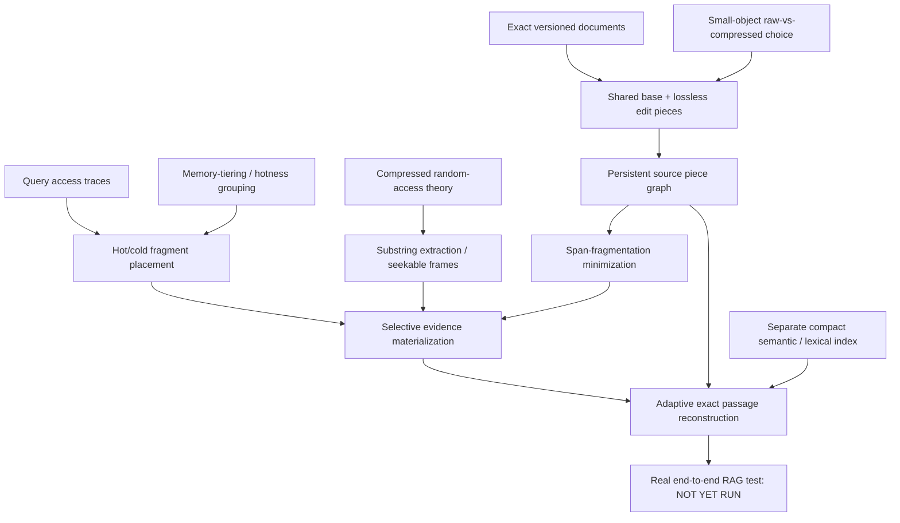

# CDG Round 6: Hot-Fragment Compression, Shared Decode Caches and Selective Evidence Materialization

Date: November 9, 2026  
Research status: Measured CPU-only experiments, **not** neural RAG or a verified novel algorithm.

## Question

Can a version-aware compressed source store allocate a small amount of extra storage and cache memory to the correct pieces, improving the speed of retrieving *exact* short evidence passages, while preserving lossless reconstruction?

## Source data and protocols

- Exactly **250 real source revisions** from noVNC at Git commit `7fcf9dcfe0cc5b14e3841a4429dc091a6ffca861`, spread across 56 file paths; 6,234,330 raw source bytes.
- For each version, previous Round 5 code establishes piece maps comprising references to shared base text plus byte-exact inserted literals. The independent 32-line Zstd-frame baseline and independent whole-document Zstd baseline are reconstructed from the same versions.
- This round uses **3,000 synthetic training access requests**, **1,000 independent held-out requests** from the original skewed popularity distribution (80% change-oriented), and **1,000 shifted held-out requests** with rotated document popularity and 35% change-oriented requests. All windows request five source lines. The source text and revisions are real; the access traces are not real user query logs.
- All tested source-storage policies reconstruct all 250 original documents byte-for-byte and every sampled held-out passage exactly.
- Timings are warm single-process Python CPU microbenchmarks; storage sizes do **not** include semantic indexes, LLM weights, SSD reads or actual RAG generation. Compact piece-map resident representation alone is **298,578 bytes**; Python object overhead is additional.

## Test A: A byte-saving decision can also speed up decoding

The per-literal Zstd-frame encoding makes many tiny edits **larger** than raw. Among 6,210 literal pieces, 3,309 use fewer bytes when stored directly than when Zstd compressed.

| Policy | Source storage B | Heldout-matched median µs | Shifted median µs | Matched p95 µs |
|---|---:|---:|---:|---:|
| Every edit in individual Zstd frame | 983,556 | 45.17 | 46.38 | 92.45 |
| Store edit raw iff shorter | **960,100** | 32.64 | 37.36 | 78.40 |
| All edits up to 64B stored raw | 961,609 | 32.27 | 36.02 | 77.63 |
| All edits up to 256B stored raw | 1,022,413 | **30.93** | **31.64** | **63.21** |
| Independent whole-document Zstd | 1,455,847 | 46.06 | 46.96 | 223.64 |
| Independent 32-line seekable Zstd frames | 2,528,761 | **26.38** | **26.39** | **54.27** |

**Interpretation:** The smaller direct/raw fragments are not merely a codec compromise. Avoiding many tiny decompress calls can improve source-access latency *and* compressed size. This is a known principle of compression engineering, not a new codec.

**Important size caveat:** The 960KB per-piece store is *larger* than Round 5's 667KB layout that uses one compressed literal buffer per version. In exchange, it avoids decompressing an entire version-specific literal buffer to recover one edit. This establishes a trade-off, not universal compression superiority. The Round 5 and Round 6 numbers were not collected in one identical timing loop.

### Demand-based selection under equal storage

A policy that uses the training access log to select which otherwise compressible literal pieces to store raw did not consistently beat the simple 256B threshold on held-out requests.

| Policy at ~1.022 MB | Matched median µs | Shifted median µs |
|---|---:|---:|
| Fixed 256-byte threshold | **30.93** | 31.64 |
| Demand-weighted selection | 30.96 | **31.10** |
| Random selection at same budget | 31.62 | 34.22 |

The variations are too small and timings too environment-sensitive to support a strong performance claim. Fixed thresholds remain the baseline to beat.

## Test B: Cross-version decoded-frame caching

Shared base fragments create more cache reuse than independent per-version frames, because many revisions can reference the same base frame.

At a nominal **64KiB decoded-frame payload budget**:

| Measure | Shared base source | Independent version frames |
|---|---:|---:|
| Cache hit rate, original query mix | **59.33%** | 20.96% |
| Median retrieval µs | **27.10** | 29.34 |
| p95 µs | 65.79 | **59.74** |

But when we include the **packed 299KB piece-map representation** in a nominal **512KiB** combined budget, the shared store's superior cache hit rate does *not* translate to a median latency advantage:

| Measure | Shared source | Independent frame baseline |
|---|---:|---:|
| Cache hit rate | **86.52%** | 62.79% |
| Median retrieval µs | 7.27 | **3.12** |
| p95 µs | 62.28 | 62.73 |

These are **nominal payload budget** comparisons, not exact RAM-budget comparisons: Python `bytes`, list, dictionary, tuple and class overhead are not comprehensively measured. There are also different numbers of frame accesses across the two architectures. Larger hit rate is not itself evidence of faster retrieval. Piece traversal and Python dispatch can negate cache benefits.

## Test C: Which requests are slow?

On 6,000 repeated measurements derived from the 2,000 held-out window requests:

| Number of referenced pieces in 5-line request | Samples | Median µs | p95 µs |
|---|---:|---:|---:|
| One piece | 2,109 | 30.16 | 70.59 |
| Two pieces | 1,449 | 32.09 | 91.20 |
| Three or more pieces | 2,442 | **46.45** | **104.19** |

Spearman correlation between piece count and latency was **+0.479**. This is an association, not causal proof: more fragmented requests may also have different byte lengths, edit structure and decoding paths. It points toward **span fragmentation** as a useful optimization objective independent of raw compression ratio and cache hit rate.

## Test D: Selective materialization of evidence windows

We hypothesized that frequently accessed **multi-piece** windows could be served through additional independently compressed 32-line snapshots, rather than repeatedly traversing the piece graph. The snapshot selection was trained on 3,000 synthetic requests. Tests use independent request draws.

At approximately **49KB added compressed-source storage**:

| Policy | Direct-frame hit rate, matched | Median µs, matched | Direct-frame hit rate, shifted | Median µs, shifted |
|---|---:|---:|---:|---:|
| No additional snapshots | 0% | 34.50 | 0% | 36.21 |
| Workload-selected snapshots | **39.6%** | **32.10** | 12.5% | 35.20 |
| Random snapshots, equal budget | 6.9% | 34.31 | 4.5% | 35.46 |

At approximately **131KB extra storage**, matched direct-hit rate reached 53.5%, but median improvements were modest. The 128KB group experienced a different run-wide timing level, so the absolute medians across budgets should not be treated as a controlled dose-response curve. Workload shifts sharply weaken the learned fast path. This is a *specialized access optimization*, not a universal speedup.

## Graph of Thoughts: updated research branches

### Three plausible research additions

1. **Span-aware coalescing rather than fragment-wise compression.** Existing tests suggest retrieval latency rises with the number of piece boundaries touched. Design a partitioner that improves the *expected number of piece traversals per query*, while still exploiting shared-version compression. Compare against static piece tables, independent seekable frames and ordinary LRU caching. This is the strongest testable systems hypothesis.
2. **Adaptive materialization with drift detection.** Rather than permanently duplicating popular windows, only promote materialized spans when expected decoding savings justify bytes and refresh cost, and de-promote them after access patterns change. Existing caching and view-materialization work is considerable, so this must demonstrate a novel workload/representation interaction rather than merely create another cache.
3. **Compressed-string random access as a replacement for ad hoc pieces.** The 2026 LZBE compressor supports logarithmic random access with space linear in compressed size; ICALP 2026 explores optimal space-time trade-offs for grammar-compressed strings. A more mature substring-extraction representation may beat Python piece traversal and better support exact evidence retrieval without many small frames.

## External research checked

- Git `pack-objects` already limits delta depth because long chains increase decompression costs: https://git-scm.com/docs/git-pack-objects
- LZBE, CPM 2026, theoretical compact direct access: https://drops.dagstuhl.de/entities/document/10.4230/LIPIcs.CPM.2026.34
- Grammar random-access trade-offs, ICALP 2026: https://drops.dagstuhl.de/entities/document/10.4230/LIPIcs.ICALP.2026.86
- Dynamic grammar-compressed self-index, ESA 2026: https://drops.dagstuhl.de/entities/document/10.4230/LIPIcs.ESA.2026.6
- OBASE, hotness-aware memory co-location: https://research.google/pubs/obase-object-based-address-space-engineering-to-improve-memory-tiering/
- Compression-aware CPU/GPU buffer management, 2026: https://link.springer.com/article/10.1007/s13222-026-00560-w
- Compressed string dictionary and sampled-workload caching: https://www.sciencedirect.com/science/article/pii/S0306437924001480

## What would establish a real advance?

The next implementation should be a **compiled Rust/C++ exact passage access core** with identical source bytes, held-out real corpus histories, and matched overall memory budgets (actual RSS or heap accounting, not just array payload sizes). It must compare against finely tuned seekable Zstd, Git's native pack delta access where appropriate, and an established compressed random-access structure. Report p50/p95, cold versus warm SSD reads, total source+metadata+index bytes, and updates. Then integrate a pretrained neural retriever and correctly labeled real-world QA.

If span-aware physical coalescing does not outperform simple seekable frames after full accounting, treat it as a rejected hypothesis. The results here support feasibility and a candidate mechanism, not a publishable novelty claim.
