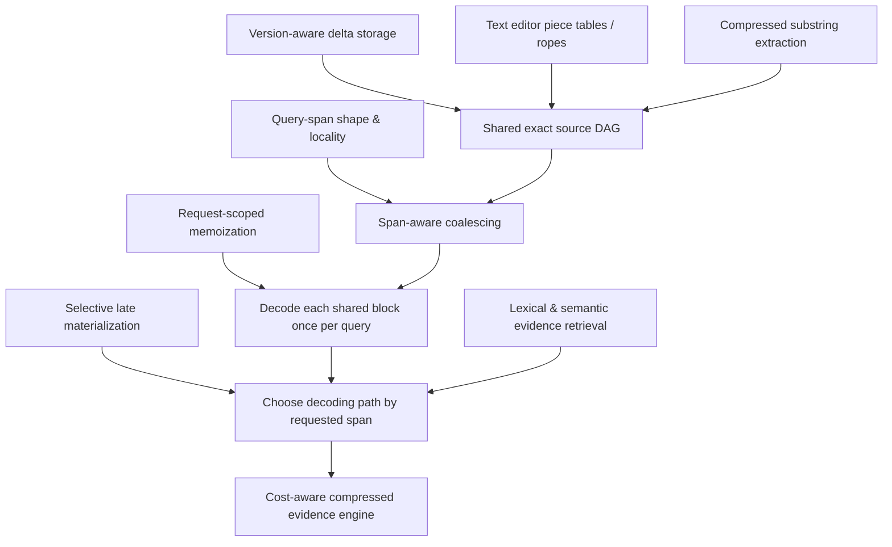

# CDG Round 7: Span-Aware Coalescing and Within-Query Decode Reuse

**Date:** November 9, 2026  
**Research stage:** Reproducible local CPU experiments, **not** measured neural RAG or demonstrated research novelty.

## Hypothesis and design

Round 6 found that retrieving short passages from a shared version-and-patch archive may require many small piece traversals and repeated decompressions of unchanged reference blocks. This round tests two distinct interventions:

1. **Bridge coalescing:** if changed fragment A and changed fragment B are separated by at most `K` unchanged lines, encode the whole contiguous region as one new literal, trading redundant source bytes for fewer source pieces and codec calls.
2. **Within-query base-frame memoization:** during a single passage extraction, decompress each referenced shared 32-line base frame at most once. This adds only transient per-query memory, not persistent compressed-source bytes.

Neither operation is a novel compression primitive. The possible systems contribution would be *joint layout selection for expected evidence-span lengths and decoding costs*, after comparison with mature compressed random-access indexes.

## Source data and evaluation

- 250 genuine source file revisions from the public noVNC Git history, pinned to commit `7fcf9dcfe0cc5b14e3841a4429dc091a6ffca861` (the local repository is `/opt/novnc`). Original source total: **6,234,330 bytes**.
- Source bytes are real, but retrieval requests are synthetic. Training queries and two held-out sets were inherited from Round 6. The held-out sets contain 1,000 queries each, one weighted toward changed regions and the other with changed popularity and fewer change-focused requests.
- Bridge thresholds `K=0,1,2,4,8,16,32` lines. Each literal is Zstandard-compressed or stored raw using the same 256-byte small-literal rule as the Round 6 reference.
- All 250 full file versions and all 2,000 held-out five-line passage requests were verified byte-for-byte under *every* bridge setting. Additional one-, five-, twenty-, and forty-line requests also passed exactness checks.
- Sizes count compressed source frames, encoded per-version literal fragments, per-fragment headers, and compact persisted piece maps. The **semantic retrieval index is not included**. Resident piece-map payload is separately counted, but Python object overhead is not. Shared base-frame directory and other incidental process memory require additional accounting.
- Timings are warm single-process Python CPU loops with randomized method and query order. No SSD I/O, full-process RSS, end-to-end RAG generation, or pretrained neural encoder.

## Experiment A: Coalescing genuinely improves both compressed-source size and short-passage read time

| Method | Compressed source bytes | Source pieces | Matched held-out median, 5 lines | Shifted held-out median, 5 lines |
|---|---:|---:|---:|---:|
| Original Round 6, 256-byte raw-literal cutoff | 1,022,413 | 14,218 | 30.66 µs | 31.12 µs |
| Bridge at most 2 unchanged lines | 950,300 | 10,474 | 29.40 µs | 29.74 µs |
| **Bridge at most 8 unchanged lines** | **880,620** | **6,828** | **28.69 µs** | **29.89 µs** |
| Bridge at most 16 unchanged lines | 893,740 | 5,550 | 28.68 µs | 29.55 µs |
| Independent whole-document Zstandard | 1,455,847 | n/a | 48.69 µs | 47.20 µs |
| Independent 32-line seekable frames | 2,528,761 | n/a | **25.71 µs** | **26.50 µs** |

`K=8` was a good storage-oriented option in the training sweep; choosing the *fastest* threshold for the held-out test would violate clean selection protocol. Since many thresholds were evaluated on the same held-out sets, the exact advantage must be checked on a new corpus before publication.

For K=8 vs the previous shared-piece layout, compressed source was **13.9% smaller**, compact per-version piece-map payload decreased from **298,578 to 143,388 bytes**, and median five-line access was around **6.4% faster** under the matched distribution. This supports reducing piece fragmentation as a meaningful optimization.

Coalescing beyond 8 lines produced more redundant copied base material and eventually increased source storage. Thus, merely minimizing the number of pieces is not sufficient.

## Experiment B: Access length changes which representation wins

Mixed held-out queries: 450 from each of the matched and shifted distributions, three randomized runs. Medians in microseconds:

| Evidence span | Original small literals | Bridge 8 | Independent whole Zstd | Independent seekable frames |
|---|---:|---:|---:|---:|
| 1 line | **20.43** | 24.84 | 47.76 | 25.44 |
| 5 lines | 32.29 | 29.96 | 48.90 | **26.74** |
| 20 lines | 74.59 | 55.82 | 49.01 | **35.61** |
| 40 lines | 111.56 | 83.28 | **49.17** | 52.61 |

**Negative result:** coalesced pieces are *slower* for single-line reads, and even though they help the earlier piece-based store for longer requests, they lose to independent decode on 20–40-line requests in this implementation. A universal decoder should not be selected based only on five-line performance. Note that the whole-document baseline may use different resident compressed bytes, and the experiment is not an equal-RAM microbenchmark.

## Experiment C: In-request repeated decompressions explain much of the long-span penalty

For K=8, a single 40-line extraction traverses on average **3.79 pieces** and makes **3.33 shared-base frame decode calls**, but touches only **2.00 distinct shared-base frames**. That is **39.7% redundant frame calls** across tested queries. At 20 lines, the redundant-call fraction is **33.6%**. At one line it is zero.

Add only a **temporary per-request dictionary** from base-frame ID to decoded line list:

| Evidence span | Without per-request memoization | With per-request memoization | Median change |
|---|---:|---:|---:|
| 1 line | 22.70 µs | 22.93 µs | Small regression |
| 5 lines | 29.56 µs | 28.62 µs | 3.2% faster |
| 20 lines | 55.92 µs | **47.39 µs** | **15.3% faster** |
| 40 lines | 81.56 µs | **60.91 µs** | **25.3% faster** |

Both readers were checked against 1,000 exact passages at every span length. This comparison is from a separate randomized run; do not mix absolute medians with Experiment B to claim an unmeasured combined speedup.

The memoized reader still trails fast seekable frames on long spans. It nevertheless demonstrates that the number of *distinct decoded shared blocks* is a more useful performance metric than just the number of piece references.

## Graph of Thoughts: Cross-disciplinary implications

The new design hypothesis is **span-shape-aware storage and execution**: choose compression boundaries based partly on the distribution of *requested evidence lengths and overlaps*, then plan at query time using a cost estimator that considers expected unique decoded frames, total bytes, and number of piece traversals.

This is not equivalent to just maximizing deduplication or to just caching hot documents. Existing research makes novelty risk high.

## Verified relevant literature and alternative mechanisms

1. **Duyster & Kociumaka, ICALP 2026**, *Random Access in Grammar-Compressed Strings: Optimal Trade-Offs in Almost All Parameter Regimes*. Establishes lower and upper trade-offs for random access, with substring extraction extensions. https://doi.org/10.4230/LIPIcs.ICALP.2026.86
2. **LZBE, CPM 2026**, *An LZ-Style Compressor Supporting O(log n)-Time Random Access*. A mature theoretical alternative to ad hoc version piece tables. https://drops.dagstuhl.de/entities/document/10.4230/LIPIcs.CPM.2026.34
3. **Cicalese et al., ESA 2026**, *Incongruity-Sensitive Access to Highly Compressed Strings*. Direct access to unusual, poorly repeated regions with bounds sensitive to surrounding repetition. https://iris.univr.it/handle/11562/1203327
4. **Ferragina, Rotundo & Vinciguerra, Information Systems 2025**, *Two-level massive string dictionaries*. Uses compressed external blocks, a succinct in-memory trie, and workload-sampled caching to improve access while keeping indexes small. https://doi.org/10.1016/j.is.2024.102490
5. **Liu et al., PVLDB 2025**, *Selective Late Materialization in Modern Analytical Databases*. Adapts when data is reconstructed based on a query and its attributes; a strong precedent for adaptive decode planning. https://doi.org/10.14778/3749646.3749717
6. **Ferrada & Navarro, Information and Computation 2019**, *Lempel-Ziv Compressed Structures for Document Retrieval*. Compressed document listing/top-k retrieval is longstanding, not a novel CDG claim. https://doi.org/10.1016/j.ic.2019.01.006
7. **MIT thesis, 2024**, *Enhancing Cloud Database Performance: General-Purpose Compression and Workload-Driven Layout*. Query-aware layout and caching have already been studied; additional claims require stronger benchmarks. https://hdl.handle.net/1721.1/153856

## Rejected assumptions and next experiment

- **Rejected:** maximizing compressed-source ratio alone optimizes passage speed.
- **Rejected:** fewer pieces universally means faster retrieval, particularly for one-line queries.
- **Not yet supported:** the current physical representation beats high-quality seekable compression under matched RAM or cold I/O.
- **Not yet supported:** compression-driven storage accelerates neural RAG end to end.

The next decisive step is an independently implemented compiled **length-adaptive exact passage reader**, with the same byte-exact source versions, full storage/RSS accounting, and end-to-end query timings. Compare coalesced shared sources with independent seekable frames and full-document Zstd at multiple span lengths. Separately, use a genuinely pretrained encoder and real QA relevance labels to see which evidence spans RAG retrieves in practice; do not assume the synthetic five-line mix reflects real workloads.

## Reproducibility

Run the package scripts from `cdg_round7/` with `CDG_NOVNC_REPO` set to a local checkout of noVNC at `7fcf9dcfe0cc5b14e3841a4429dc091a6ffca861`. The included Round 6 package supplies imports and the original trace generator. The scripts reconstruct and verify all source versions; the actual noVNC Git checkout is **not** embedded in the archive. Required: Python, NumPy, SciPy, scikit-learn, and `libzstd` (used via `ctypes`). The main tests are in `round7_span_coalescing.py`, `round7_base_decode_cache.py`, and `round7_frame_accounting.py`. Outputs are JSON.
