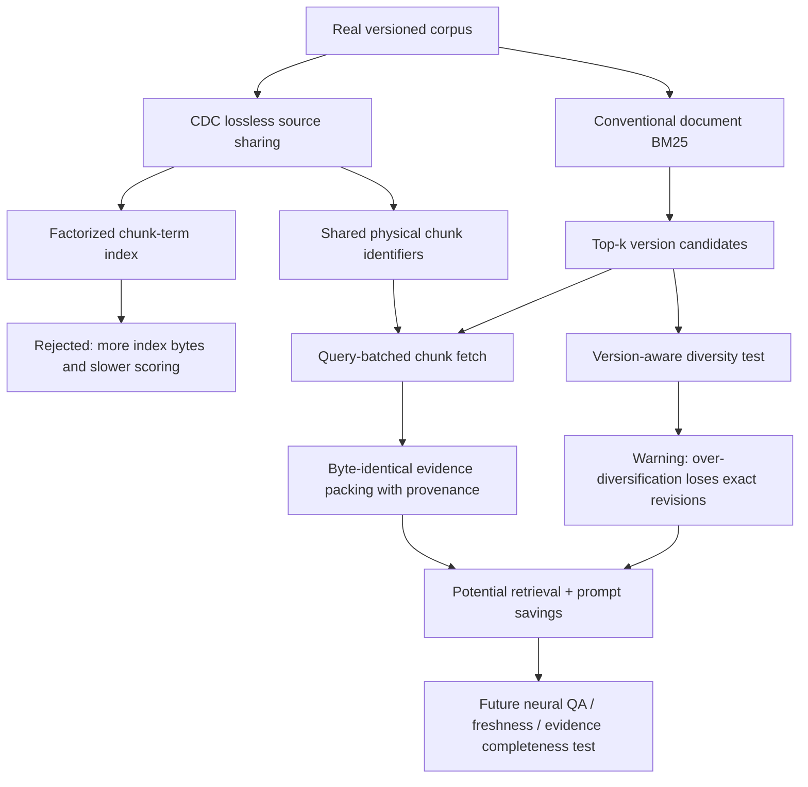

# CDG Round 8: Retrieval-Conditioned Sharing from Disk Through the Prompt

**Date:** November 9, 2026  
**Status:** Small-scale, real source-version corpus with human-written commit subjects and synthetic extractive evidence windows. No neural embeddings, LLM generation, or production I/O benchmarks.

## Research question

Can an exact, deduplicated document store make RAG cheaper **after** candidate retrieval, even if factorizing the lexical retrieval index itself is less efficient than ordinary postings?

This round treats physical source identity and retrieval ranking as separate layers, then tests whether source identities can reduce repeated decompression and repeated prompt text while preserving each snippet's association with its source version.

## Graph of Thoughts: independent hypotheses and experimental results

## Dataset and exact reproducibility scope

- **250 genuine noVNC Git file revisions**, drawn from **56 source paths**; human-written commit subjects serve as queries. Local Git HEAD: `7fcf9dcfe0cc5b14e3841a4429dc091a6ffca861`.
- **6,234,330 raw source bytes**. CDC32 representation: **1,573 distinct chunks**, **5,947 logical chunk references**.
- Query selection: seeded random split of 100 training and 150 held-out commit subjects. The training queries are used only to choose which optional postings to materialize; test queries are held out.
- Fixed tokenization of source and query with `(?u)[a-z][a-z0-9_]+`. This is a **source-code lexical retrieval proxy**, not a neural semantic benchmark or human-annotated question-answering dataset.
- Zstandard level 3 via system libzstd, Python 3.13, NumPy, SciPy sparse arrays. Measurements are warm in-memory CPU operations, not SSD I/O or end-to-end model inference.
- For every source version, term counts factorized through CDC chunk memberships were verified against direct full-document tokenization. All 250 BM25 score vectors matched between methods. For selected passage tests, every reconstructed five-line passage matched original source bytes.

## Experiment A: Factorized exact BM25

Let `M[d,c]` count chunk `c` in document `d` and `C[c,t]` count term `t` in chunk `c`. Then the document-term matrix is exactly `F = M @ C` for this tokenizer. Given `F`, each BM25 score can be reconstructed without indexing each document's token occurrences separately.

**Result:** Exact mathematical factorization works, but an implementation advantage did not appear.

| Measure | Ordinary document-term postings | Factorized chunk-term index |
|---|---:|---:|
| Compressed integer matrix data | 73,233 bytes | 128,100 bytes, including chunk membership |
| Held-out median query scoring | 46.91 µs | 180.66 µs |
| Held-out p95 scoring | 106.45 µs | 298.09 µs |
| BM25 score agreement | Baseline | All 250 queries |

The common compressed vocabulary occupies another 37,594 bytes. Materializing hot-term postings for 10% or 30% of the most frequently queried training terms was **slower** than the factorized baseline, roughly 216 and 221 µs median, respectively.

This is a negative result. Do not pursue simple matrix factorization as a replacement for an optimized inverted index in the first CDG implementation.

The ordinary BM25 index itself scored only Hit@5 = **28.4%** against the specific associated commit revision across 250 queries, illustrating the weakness of this task's retrieval proxy. Equal rankings do not imply useful end-user RAG accuracy.

## Experiment B: Query-batched evidence reconstruction

After holding the BM25 candidate list fixed, each document contributes a five-line evidence window centered on a line with the most query-term matches. Compare independent seekable 32-line Zstd frames to content-defined shared chunks. In the batched mode, each unique chunk is decoded at most once *per query* even if multiple retrieved versions reference it.

**Source storage and chunk metadata:** 2,609,744 bytes for independent frames versus 769,939 bytes for deduplicated CDC32. Both support exact selected reads and reconstruct original files.

| Retrieval workload | Independent frames median | Shared CDC32 batched median | Independent payload bytes/query | Shared payload bytes/query |
|---|---:|---:|---:|---:|
| BM25 top 5 | 119.39 µs | 84.10 µs | 2,744 | 1,789 |
| BM25 top 10 | 231.14 µs | 145.08 µs | 5,466 | 3,020 |
| Random top 5 | 122.85 µs | 127.85 µs | 2,518 | 2,703 |
| Random top 10 | 243.13 µs | 239.25 µs | 5,071 | 5,234 |

These timing measurements **exclude** BM25 scoring, source catalog loading, SSD I/O, embedding inference, context processing and generation. They are per-query batch assembly times in the Python implementation. The random-controls show that no universal read-speed advantage has been established.

## Experiment C: Evidence diversity stress test

The top-ten BM25 results contained only **2.50 distinct source paths on average**. A postranking constraint restricting the number of versions per source path changed the trade-off as follows (150 held-out queries):

| Top-10 candidate rule | Mean distinct source paths | Exact associated version Hit@10 | Shared CDC bytes/query | Independent bytes/query |
|---|---:|---:|---:|---:|
| No source-path cap | 2.50 | 38.67% | 3,020 | 5,466 |
| Maximum 2 per path | 6.13 | 32.67% | 4,782 | 5,508 |
| Maximum 1 per path | 10.00 | 26.67% | 6,040 | 5,493 |

The cache gains concentrate in highly overlapping candidate sets. Forcing diversity removes much of the sharing and can omit the exact target version. But exact-version Hit@10 is **not** a substitute for answer correctness or complementary-evidence recall. Versions within a source path may contain different facts. Avoid treating path identity as proof of evidence equivalence.

## Experiment D: Exact prompt-evidence packing

Rather than repeat byte-identical five-line passages across multiple retrieved versions, pack each unique passage once and preserve a provenance map listing all the source revisions and line ranges that contained it.

| Workload | Original evidence bytes/query | Unique evidence bytes/query | Mean distinct passages | Raw text reduction |
|---|---:|---:|---:|---:|
| BM25 top 5 | 1,003 | 425 | 2.10 | 57.9% (per-query mean) |
| BM25 top 10 | 2,011 | 648 | 3.17 | 68.1% (per-query mean) |
| Random top 5 | 914 | 829 | 4.53 | 9.2% |
| Random top 10 | 1,873 | 1,557 | 8.19 | 17.1% |

The average **naive JSON provenance map** for BM25 top-ten examples occupied roughly **683 additional bytes**, meaning the 68% text-only reduction is **not** a 68% reduction of a complete serialized prompt with full provenance. Tokenized-text reduction is only a tokenizer proxy, and LLM accuracy, prompt serialization, or output tokens were not measured.

Critically, identical passages do not represent independent corroboration. A compressed evidence set should preserve provenance and the distinct changed spans that can alter the answer, not silently collapse them.

## New cross-field synthesis

Three mature systems techniques meet at a more defensible design:

1. **Ordinary efficient search engine** to rank candidates (BM25 or a compact neural retriever). Exact factorization is not needed to save source bytes.
2. **Content-addressed source storage** to share exact chunks among versions and decode each required chunk only once per query.
3. **Provenance-preserving evidence packing** to send one copy of shared exact evidence to the generator, with version-specific differences retained and source lineage explicit.

This could reduce redundant work in three stages, but the tested benefit is strongest on a redundant candidate list, which may be undesirable for tasks requiring varied evidence. The next decision should be driven by evidence-level correctness, not maximized cache-hit rate.

## Closest prior art and non-novel components

- Hugging Face Xet specification: chunk-level deduplication, independently addressable compressed chunks, reconstruction metadata, and contiguous run coalescing. https://huggingface.co/docs/xet/en/deduplication and https://huggingface.co/docs/xet/main/en/file-reconstruction
- *RARE: Redundancy-Aware Retrieval Evaluation Framework*, ACL 2026. RedQA tests retrieval where many documents share evidence and rare facts are difficult to retrieve. https://aclanthology.org/2026.acl-long.923/
- *How retriever redundancy and diversity impact RAG effectiveness*, August 2026 preprint. Shows varied evidence can substantially aid generation under controlled conditions. https://arxiv.org/abs/2608.13956
- *Finding the Right Balance: Relevance and Diversity in LLM Retrieval*, October 2026 preprint. Already investigates query-adaptive diversification based on redundancy and required evidence count. https://arxiv.org/abs/2610.09412
- *Safe and Sufficient Caching*, EMNLP Industry 2026. Validates evidence reuse against document freshness and access controls. https://aclanthology.org/2026.emnlp-industry.75/
- *CompactDS*, ICLR 2026, combines compact approximate search and on-disk exact search. https://proceedings.iclr.cc/paper_files/paper/2026/hash/114273bb8d7969c60ab2a97adad609e1-Abstract-Conference.html

**Novelty status:** None of the components of this round is novel by itself. Even cross-layer evidence caching has extensive literature. The plausible research contribution would need to be a measured *end-to-end* policy that balances byte savings, version-specific evidence correctness, diversification, and source freshness better than existing pipelines.

## Proposed Round 9 hypothesis

**Compressed evidence equivalence classes:** group exact evidence passages, retain a compact lineage/provenance map, and keep semantically significant edits as separate evidence objects. A query planner retrieves more *distinct answer-bearing evidence* while the cache minimizes duplicate physical decoding.

The first meaningful test should evaluate these variables together:

- Correct version-specific evidence recall and multi-evidence completeness, on RedQA and a real versioned QA benchmark.
- Retrieval latency including strong pretrained neural encoders, rerankers, document access and top-k selection.
- Total resident memory plus compressed disk, with provenance maps and exact source content counted.
- Prompt tokens and generation quality after exact evidence packing, relative to ordinary RAG and naïve deduplication.
- Cold/warm cache behavior, batch size, and shifted workloads.

At present, **a publishable algorithmic contribution is not established**. Round 8 instead delivers a useful architectural pruning result: do not force source compression and retrieval-index compression into one factorized structure; use sharing where it measurably helps.

## Reproducibility

Files: `run_round8.py`, `round8_batch_fetch.py`, `round8_diversity.py`, `round8_evidence_pack.py`, matching JSON outputs, and copied dependency scripts. A local noVNC Git history must be present at `/opt/novnc` (or set `CDG_NOVNC_REPO`). The checkout is **not** distributed in this package. Requires Python 3.10+, NumPy, SciPy, and system `libzstd`. Tests were run under Python 3.13.5, NumPy 2.3.5, SciPy 1.17.0.
