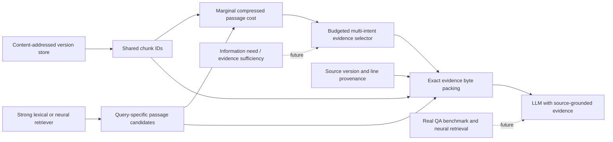

# CDG Round 9: Provenance-preserving evidence packing and marginal passage-cost retrieval

**Date:** November 9, 2026  
**Status:** Measured local experiments on genuine noVNC Git source histories, plus synthetic multi-intent tasks. **No pretrained neural retriever, LLM answer generation, or disk I/O timing.**

## Research objective and hypothesis

Can a single physical identity graph for duplicated document source data support (1) compact model-facing evidence that retains version references and (2) cost-aware retrieval that chooses complementary evidence based on the *actual compressed passage bytes* the system must fetch, without sacrificing retrieval coverage?

The hypothesis combines classical content-addressed storage, cost-based database query planning, pointer-preserved context compression, and multi-evidence retrieval. **None of the component techniques is new.** The research question is whether their joint operation improves a measured end-to-end frontier against mature systems.

## Setup

- Repository: `/opt/novnc`, HEAD `7fcf9dcfe0cc5b14e3841a4429dc091a6ffca861`.
- Corpus: 250 real file revisions from 56 paths, totaling ~6.23 MB of source. Source retrieval is lexical BM25.
- The 150 held-out original commit subjects are real human-written queries; 100 training subjects form a separate split.
- Multi-intent tasks: 75 held-out pairs and 50 training pairs constructed by combining independent commit subjects from *different* file paths. Targets are exact associated file revisions. These are **synthetic two-intent retrieval tasks**, not gold multi-hop QA questions.
- Compressed bytes are measured as the union of individually Zstd-compressed content-defined source chunks. No physical SSD I/O is involved.
- Source passage evidence: fixed five-line windows selected from each candidate version by query-term overlap, without using target labels at inference.

## Experiment A: model-facing evidence packing with full inline provenance

A fixed BM25 candidate set is used. Identical *byte-level* selected passages are emitted once with all source-version/line-range references in the prompt. Non-identical passages remain separate. Every passage/ref in the grouping is matched against original source bytes.

| Candidate set | Original evidence with references | Packed evidence with all inline references | Mean byte reduction | Word-token proxy reduction |
|---|---:|---:|---:|---:|
| BM25 top 5 | 1,074.4 B | 500.8 B | 53.4% | 52.7% |
| BM25 top 10 | 2,154.0 B | 789.5 B | 63.3% | 63.6% |
| Random top 10 | 1,989.8 B | 1,739.6 B | 12.6% | 11.5% |

The visible reference list is counted in the packed number. There is an alternative binary provenance sidecar, but the prompt packing figures **do not** assume hidden server-side source metadata. A source with the same passage text is not automatically an independent corroborating source.

**Limitations:** there is no LLM tokenizer, generation-quality test, citation-following test, or external data in this benchmark. The prompt layout is a simple research serialization, not a robust production protocol. The BM25-selected candidates are unusually redundant.

## Experiment B: multi-intent source selection, naive physical cost estimate

Methods compared: BM25 of combined question, alternating two individual BM25 query rankings, reciprocal rank fusion, and a cost-aware branch-balanced selector using whole-document union of compressed chunks. Cost-policy penalty selected only on the 50 training pairs.

| Method | Exact two-revision Hit@10 | Compressed whole-document chunk union |
|---|---:|---:|
| Combined BM25 | 4.0% | 55.7 KB |
| Two-branch round robin | 9.3% | 55.4 KB |
| Reciprocal rank fusion | 4.0% | 60.0 KB |
| Whole-document cost-aware | 12.0% | 37.4 KB |

However this was **misleading as a RAG retrieval-cost claim**. The system did not fetch whole source documents; it fetched short passages. A separate audit found:

| Method | Actual compressed chunk payload needed for five-line evidence windows |
|---|---:|
| Combined BM25 | 3.169 KB |
| Two-branch round robin | 3.612 KB |
| Reciprocal rank fusion | 3.518 KB |
| Whole-document cost-aware | **3.726 KB** |

Thus the method minimized the wrong quantity and actually *increased* passage-level compressed access costs. This negative result motivated Experiment C.

## Experiment C: optimizing marginal cost of actual evidence passages

A more accurate selector reconstructs each candidate's query-matched five-line location and computes the incremental compressed chunk payload for that window relative to chunks already selected. Candidates are chosen under a balanced two-branch schedule by maximizing normalized branch BM25 score minus a learned penalty on extra compressed passage KB. Penalty `0.2` selected from 50 training pairs. Held-out is 75 pairs.

| Method | Both exact revisions retrieved @10 | Compressed passage payload |
|---|---:|---:|
| Combined BM25 | 4.0% | 3.169 KB |
| Two-query round robin | 9.3% | 3.612 KB |
| Previous whole-document cost-aware | 12.0% | 3.726 KB |
| Passage-cost-aware, train-selected parameter | **13.3%** | **2.974 KB** |

The measured difference corresponds to about **6% fewer compressed passage bytes** versus combined BM25 and about **18% fewer** versus round-robin. Those are mean compressed payload unions only, not retrieval latency. Exact task completion is still poor; this is a small proxy experiment and must not be represented as an improvement to answer accuracy.

An 8-point test sensitivity sweep was run **without using test values for selection**. The selected parameter was the largest value in the predeclared grid, so a larger training-range sweep or regularization check is warranted.

## Graph of Thoughts: causal research connections

The architecture decouples search-index design from source storage. Previous experiments established that the straightforward factorized BM25 index was *larger and slower* than normal postings. Sharing is useful in evidence fetching and prompt composition even where it hurts ordinary search.

## Primary related research and novelty obstacles

1. **RARE/RedQA**, ACL 2026, establishes the difficulty of high-redundancy retrieval and evaluates atomic-fact redundancy. https://aclanthology.org/2026.acl-long.923/
2. **From Evidence to Exact Answers**, EMNLP 2026, already demonstrates strong copy-preserving evidence compression, a serious prior-art comparator for prompt packing. https://aclanthology.org/2026.emnlp-main.849/
3. **Submodular Evidence Selection for Grounded Answer Generation**, TREC RAG 2025, already combines relevance, coverage, diversity and evidence compression. https://trec.nist.gov/pubs/trec34/papers/WING-II.rag.pdf
4. **Efficiency vs. Verifiability**, CustomNLP4U 2026, shows compressed prompts may preserve answer accuracy while significantly reducing citation grounding. https://aclanthology.org/2026.customnlp4u-1.19/
5. **CacheBlend**, EuroSys 2025, already reuses precomputed KV work for multiple retrieved chunks. https://www.microsoft.com/en-us/research/publication/you-only-prefill-once-combining-cached-knowledge-for-large-language-model-serving-with-cacheblend/
6. **SARA**, ACL 2026, preserves fine-grained exact evidence while compacting other semantic context. https://aclanthology.org/2026.acl-long.661/

**Novelty verdict:** The present mechanisms are established or plausible integrations, not an independently demonstrated novel research algorithm. A contribution would require a better storage / passage decode / prompt-token / correctness frontier than modern specialized baselines on meaningful question-answering labels.

## Next falsifiable experiments

- Run a pretrained neural retriever and explicit exact-version gold evaluation on RARE RedQA and a time/version-aware QA dataset; keep conventional BM25 and compact dense ANN as strong controls.
- Compare physical passage-byte-aware selection to relevance-only, MMR, trained query routing, and greedy submodular coverage, at equal candidate budget and without oracle evidence access.
- Measure actual token counts and LLM citation accuracy for packed evidence. Ensure that distinct versions with incompatible facts are **never** merged without preserving changed bytes and source associations.
- Test random access under cold SSD reads and realistic compressed metadata/RAM accounting. Include decompression, prompt processing and generation time to assess actual RAG latency.
- Assess shifted query distributions, entirely new document domains, and training/heldout cross-validation; examine relative performance at increasing source redundancy.

## Reproducibility

- `round9_packing.py` for exact packed prompt study.
- `round9_multi_intent.py` for the first source-retrieval comparison.
- `round9_passage_costs.py` for physically relevant five-line compressed payload audit.
- `round9_passage_rerank.py` for corrected train-selected marginal passage-cost optimization.
- `round9_*.json` provides raw aggregate result dictionaries, training sweeps and caveats.
- `run_round8.py` and its dependencies are from the prior local experiment package. The real `/opt/novnc` repository checkout is **not** redistributed.
- Runtime: Python 3.13, NumPy, SciPy, system libzstd. Each test reconstructs exactly from the original source corpus; no model downloads used.
