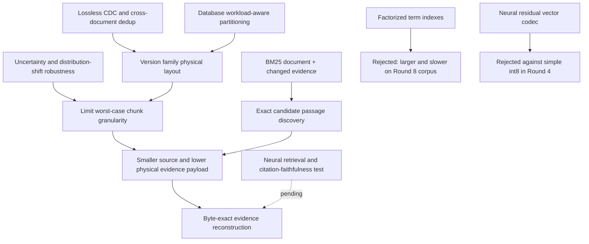

# CDG Round 10: Robust workload-shaped lossless storage and strong retrieval controls

**Date:** November 9, 2026  
**Research status:** Repeatable *local* microbenchmarks on genuine Git source-version content. No pretrained neural embeddings, LLM answer generation, real SSD timings, or independent QA labels.

## Executive findings

This round tested two previously conflated claims: (1) that physically cheap evidence selection improves retrieval quality, and (2) that compression-chunk size can be jointly optimized for storage and the physical bytes of evidence retrieval. The first is weak against strong controls; the second is promising on this one corpus.

1. **Strong retrieval dominates selection policy.** Hybrid BM25 over full source and actual changed regions retrieves both exact target revisions for 22/75 held-out synthetic paired commit queries (29.3%). A cost-aware selector achieves the same 22/75 at 2,667.9 rather than 2,944.0 compressed passage bytes per query (9.4% less). Adding query-term coverage retrieves 23/75, not a convincing improvement over 22/75. The older Round 9 10/75 success figure used a considerably weaker retrieval baseline.
2. **Fixed compression granularity wastes opportunities.** Across 250 true noVNC source revisions and 56 paths, uniform 32-line CDC chunks occupy 716,789 bytes of static source storage and require 3,019.8 mean compressed chunk bytes for held-out top-ten evidence. A family-specific, training-workload-aware chunk layout occupies 635,113 bytes and requires 1,760.4 evidence bytes, about 11.4% less storage and 41.7% less evidence payload than uniform 32-line chunks.
3. **Storage-only family decisions explain some improvement but not all.** The storage-only per-family chunk choice uses 626,662 bytes and retrieves 2,372.5 payload bytes per held-out query. The workload-aware mixture uses 1.35% more source storage for 25.8% less payload. A simple popularity-only family policy also does worse in this comparison (671,888 source bytes, 2,038.5 payload bytes).
4. **Unseen workload costs can reverse.** The original mixed layout requires 7,793.1 compressed payload bytes on requests focusing on training-unpopular families, compared with 5,144.8 for uniform 32-line chunks. Cap the chunk size at 32 lines for paths appearing in at most one training request, and mixed source size becomes 639,393 bytes, normal held-out payload 1,705.3 bytes, and training-unpopular-family payload 5,144.8 bytes.
5. **This is not yet evidence of faster neural RAG.** With Python-managed requests and warm native Zstandard decoding, median measured *payload decompression* times are close across layouts. Python overhead, real physical reads, indexing cost, neural retrieval, provenance processing, prompt tokens, and generation remain unevaluated.

## Dataset, splits, and scope

- Source repository: public noVNC Git history, exact tested commit `7fcf9dcfe0cc5b14e3841a4429dc091a6ffca861`.
- 250 real historical file contents from 56 source paths; 6.23 MB raw bytes in the same underlying corpus as prior rounds.
- Human-authored original commit messages provide 250 retrieval queries. BM25 source selection uses 100 training queries and 150 held-out queries.
- Two-part retrieval proxy: 50 training pairs and 75 held-out pairs, each synthesized by combining two human-written commit messages about different source paths. Correctness is exact identification of both associated file versions, **not** answer correctness or human-annotated sufficient evidence.
- All source compression is lossless. Direct byte equality was validated for 250 reconstructed versions per tested layout. Individual compressed chunks were round-trip verified for principal layouts. The storage byte totals include compressed unique chunk payloads, compressed document manifests, compressed chunk-length catalogs, and a small static header. They **exclude** search-index storage, allocator memory, network and SSD accesses.
- Retrieval passage cost is the union of individually compressed source chunks intersecting ten selected five-line windows. It is not observed disk-read traffic. Retrieval rank orders are fixed across layout choices to isolate physical storage effects.

## Experiment A: strong change-aware retrieval, cost and coverage selection

| Search and selection method | Exact both-revisions Hit@10 | Mean compressed five-line payload |
|---|---:|---:|
| Hybrid BM25 combined scores | 21.3% (16/75) | 2,764.5 bytes |
| Changed-evidence BM25 combined | 28.0% (21/75) | 2,122.8 bytes |
| Hybrid BM25 branch round-robin | 29.3% (22/75) | 2,944.0 bytes |
| Hybrid BM25 with training-selected byte penalty | 29.3% (22/75) | 2,667.9 bytes |
| Hybrid BM25 with training-selected novelty and byte penalty | 30.7% (23/75) | 2,710.3 bytes |
| Old Round 9 cost-aware selector with weaker index | 13.3% (10/75) | ~2,974 bytes |

The scoring index mixes query-normalized changed-region and full-document BM25 scores. The byte-aware selection considers exact compressed-passage chunk cost of candidates, not complete source-file costs. Novelty is an IDF-weighted measure of previously uncovered query terms in candidate changed regions. Parameters are selected on the 50 training pairs from a predeclared grid; test labels are not used for selection.

**Interpretation:** A new selector's tiny improvement over a strong retriever is not evidence of a novel RAG method. A fair end-to-end study requires serious retrieval and multi-hop QA controls.

## Experiment B: source chunk granularity

All sizes are content-defined, line-based chunk-size *targets*. They are not equal-size blocks or learned semantic chunk boundaries. All indexes search the same document set.

| CDC target (lines) | Static source archive | Mean compressed held-out top-ten evidence bytes | Median warm payload decode |
|---:|---:|---:|---:|
| 8 | 780,119 bytes | 1,154.7 | ~112 μs |
| 16 | 728,270 bytes | 1,858.6 | ~112 μs |
| 32 | 721,391 bytes | 3,019.8 | ~120 μs |
| 64 | 762,117 bytes | 5,509.2 | ~133 μs |
| 128 | 813,329 bytes | 9,683.5 | ~162 μs |

This preliminary sweep includes an explicit compressed offset catalog. The next experiment uses a slightly more compact, but information-equivalent, length-based catalog which allows offsets to be derived cumulatively, so static archive byte totals differ slightly. Comparisons *within* each experiment use the same accounting.

## Experiment C: family-specific physical compression

| Variant (same catalog accounting) | Static source bytes | Normal held-out mean payload bytes | Cold-family stress mean payload bytes |
|---|---:|---:|---:|
| Uniform target 8 | 766,187 | 1,154.7 | 2,759.8 |
| Uniform target 32 | 716,789 | 3,019.8 | 5,144.8 |
| Per-family, minimize source bytes only | 626,662 | 2,372.5 | 7,793.1 |
| Popularity-only hot 8/cold 32, train-tuned | 671,888 | 2,038.5 | 5,144.8 |
| Family-aware mixed, nominal horizon 50 | 635,113 | 1,760.4 | 7,793.1 |
| Family-aware mixed, nominal horizon 200 | 674,704 | 1,374.9 | 7,675.4 |
| **Mixed, max 32 lines for families with ≤1 training request** | **639,393** | **1,705.3** | **5,144.8** |

The numerical amortization horizon is a chosen trade-off scale between one-time archive storage and compressed bytes read per query. It is not a validated monetary objective. The family layouts are chosen using the training set, though horizons were all investigated and should not be retroactively treated as a single preregistered winner.

**Paired 95% bootstrap interval, held-out physical-byte reduction (mixed h50 relative to other layouts):**

- vs uniform target 32: mean −1,259.5 bytes/query, 95% interval [−1,519.4, −1,010.4].
- vs family storage-only: mean −612.1 bytes/query, interval [−766.3, −470.4].
- vs train-tuned simple popularity layout: mean −278.2 bytes/query, interval [−433.1, −128.4].

Bootstrap resampling units are queries, not individual chunk accesses. Confidence intervals reflect variation *within this fixed corpus and generated workload*, not external-domain generalization.

**Cold-family stress:** Original mixed h50 fetched +2,648.4 bytes/query more than global 32, interval [+2,467.5, +2,838.5]. The low-observation cap removes that excess in this constructed stress pattern. This is an unusually targeted shift, not a production-workload forecast.

### Decoding caveat

Warm native Zstandard payload decoding, five randomized repetitions per held-out query, produced medians in the neighborhood of 105–120 microseconds across main layouts. These differences are too small and environment-sensitive to support a claim of meaningful end-to-end speedup. Fewer compressed source bytes is an *I/O-volume potential*, not observed faster retrieval or generation.

## Graph of Thoughts: what survived and what was pruned

Key inference: the physical storage partition is a *separate controllable design axis* from the text passages the retriever indexes. A smaller source chunk is not necessarily a better semantic passage, and an effective retrieval passage need not be a physically contiguous compressed block.

## Primary-source literature and novelty audit

1. **Enhancing Cloud Database Performance: General-Purpose Compression and Workload-Driven Layout**, Piszczek, MIT thesis, 2024. Establishes workload-aware data layout and caching in compressed cloud databases: https://dspace.mit.edu/entities/publication/c2b6e358-c2b2-477f-8c1a-2d04ae4fe10f
2. **R2D2: Reducing Redundancy and Duplication in Data Lakes**, SIGMOD 2024. Joint storage/access decisions for redundant datasets: https://research.adobe.com/publication/r2d2-reducing-redundancy-and-duplication-in-data-lakes/
3. **Adaptive Chunking: Optimizing Chunking-Method Selection for RAG**, 2026. Per-document semantic retrieval chunking optimization, distinct from physical source compression granularity: https://arxiv.org/abs/2603.25333
4. **SmartChunk Retrieval**, ICLR 2026. Query-adaptive semantic retrieval granularity: https://proceedings.iclr.cc/paper_files/paper/2026/hash/5c1ff00b27ba052039bb41531236baac-Abstract-Conference.html
5. **When Knowledge Is Not Free**, Findings EMNLP 2026. Strong prior art for budgeted selection, though costs are source access tiers rather than deduplicated physical evidence reads: https://aclanthology.org/2026.findings-emnlp.413/
6. **GeoRAG: Covering the Unseen**, June 2026 preprint. Strong prior art for subquestion coverage selection: https://arxiv.org/abs/2606.29328
7. **TimelyRAG**, Findings EMNLP 2026. Handles overlapping, evolving temporal documents and is a relevant version-specific retrieval baseline: https://aclanthology.org/2026.findings-emnlp.398/
8. **The Attribution–Compression Frontier**, GroundLM 2026. Shows that original source attribution must be measured separately from compressed-context answer correctness: https://aclanthology.org/2026.groundlm-1.65/
9. **Coresets for Robust Query Optimization**, SIGMOD 2026. Direct relevance to robustness against uncertain workload estimates: https://scholars.duke.edu/publication/1822349

**Novelty assessment:** Source-family-specific chunk sizing, workload-aware layout, deduplicated evidence bytes, and risk-aware fallback are *not inherently novel*. The mixed physical source optimization shown here has encouraging numerical results but has not been benchmarked against industrial physical-design optimizers or demonstrated across external domains. An original contribution may require a new robust constrained optimizer, stronger evidence-preservation guarantees, or a demonstrable end-to-end Pareto frontier not achieved by existing compressed storage + retrieval systems.

## Next falsifiable studies

1. **Cross-domain generalization:** Run the physical layout experiment unchanged on real Wikipedia page histories, regulatory amendments, and large documentation/version corpora. Hold out entire document families, not only queries from already-known families.
2. **Strong RAG:** Use pretrained encoders, temporal version-aware retrieval, BM25 and hybrid search, plus real multi-evidence QA labels. Measure complete evidence recall and citation fidelity.
3. **Actual access and latency:** Rust or C++ seekable chunk store with cold/warm SSD reads, index RAM, update costs, re-chunking costs, and p50/p95/p99 end-to-end times.
4. **Robust optimization:** Evaluate alternate workload distributions and formal worst-case regret constraints rather than a post-hoc cap. Compare against storage-only and popularity-only controllers, and reorganization overhead.
5. **Cross-layer sharing:** Measure whether data chunk identity reuse also improves batching and exact passage packing in actual LLM generation, while preserving all distinct changed statements.

## Reproduction

Package includes:

- `round10_strong_retrieval.py` and `round10_strong_retrieval_results.json`
- `round10_chunk_granularity.py` and `round10_chunk_granularity_results.json`
- `round10_mixed_layout.py` and `round10_mixed_layout_results.json`
- `run_round8.py`, `round9_multi_intent.py`, and supporting `dependencies/` from prior rounds (included for reproducibility)

Use Python 3.12+ with NumPy, SciPy, scikit-learn, a system `libzstd`, and a clone of the public `novnc/noVNC` repository checked out at the SHA above. Point `CDG_NOVNC_REPO` at your checkout. Scripts enumerate commits and create deterministic queries and data; no model weights or remote data are bundled. Actual compression byte counts require reproducing the exact noVNC source snapshot and compatible Zstandard codec.
